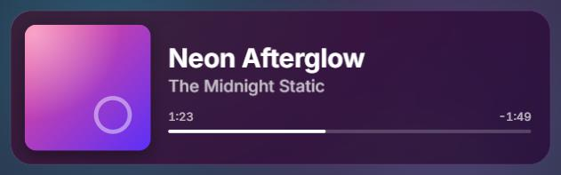
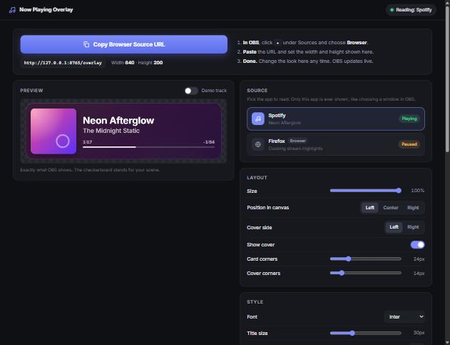

# Now Playing Overlay for OBS

A local "now playing" overlay for OBS. It reads the music app you choose (Spotify by default; Qobuz,
Apple Music, VLC, a browser, …) and shows the current track as a clean, animated browser source.

**Windows and Linux. No accounts, API keys or logins. Everything stays on your computer.**



## Setup in 3 steps

1. **Download** the latest release from the [Releases page](https://github.com/stayn172/obs-now-playing/releases/latest)
   and unzip it anywhere (Windows: `obs-now-playing-vX.Y.Z-win64.zip`;
   Linux: the `.AppImage` or the `.tar.gz`).
2. **Run** `obs-now-playing.exe` (Linux: the AppImage or `obs-now-playing`). A settings page opens in your browser.
3. **Click "Copy Browser Source URL"**, then in OBS: Sources → **+** → **Browser** → paste the URL,
   set **Width 640** and **Height 200** → OK.

That's it. You never have to touch the source in OBS again: every change you make on the settings page
shows up in OBS live.



## Choosing what it shows

There is **no automatic detection**. The overlay shows exactly one app: the one you pick, like
choosing a window for OBS Game Capture.

- The default is **Spotify**. Pick any other open app in the **Source** list on the settings page.
- If the chosen app isn't running, the overlay stays **empty**. Nothing else is shown instead, so a
  YouTube video in your browser never pops up as a "song" unless you picked that browser.
- Picking a browser shows whatever plays in it, videos included (the settings page reminds you).

## Start and stop with OBS (optional)

The release folder contains `obs-now-playing.lua`. In OBS open **Tools → Scripts**, click **+** and add it.

- When OBS starts, the app starts in the background (no browser window).
- When OBS exits, the app closes again, but **only if OBS started it**. If you started it yourself
  or it starts with Windows, it keeps running.

Prefer it always on? Use **Start with Windows** (Linux: *Start when I log in*) on the settings page or in the tray menu.

## Features

- Rounded cover art, bold title, artist, elapsed and remaining time, thin progress bar
- Glass look: a blurred, saturated copy of the cover behind a translucent dark card
- Smooth cover crossfade and text slide on track change, scrolling for long titles
- Progress animated between updates, so the bar moves smoothly
- Hide when paused, hide during ads, fade duration, cover left/right, corner radii, size,
  fonts (Inter, Montserrat, Poppins, Roboto, bundled), text and accent colours, optional app label
- Tray icon: Open settings, Copy OBS URL, Start with Windows, Quit
- Uses about 0% CPU while idle

## Supported players

Anything that appears in Windows' media controls (the media pop-up next to the volume flyout) or,
on Linux, any MPRIS player should work. What has actually been checked:

| Player | Windows | Linux |
|---|---|---|
| Spotify desktop (classic installer) | ✅ tested | not yet tested |
| Spotify (Microsoft Store) | expected (same app id family) | — |
| Firefox (YouTube etc.) | ✅ tested | not yet tested |
| Qobuz, Apple Music, TIDAL, Deezer | expected, not yet tested | — |
| Chrome, Edge, Brave, Opera, Vivaldi | expected, not yet tested | not yet tested |
| VLC, foobar2000, MusicBee, AIMP, Media Player | expected, not yet tested | VLC / mpv / Rhythmbox / Elisa: not yet tested |

Tried another player? Please open an issue saying whether it works.
`python -m tools.list_players` (from source) lists everything the app can see.

## Troubleshooting

**Windows SmartScreen says "Windows protected your PC".**
The app isn't code-signed. Click *More info* → *Run anyway*. The download page lists SHA-256
checksums (`SHA256SUMS.txt`) if you want to verify the file.

**My antivirus flags it.**
Apps packaged with PyInstaller are sometimes flagged by heuristics. The release is built from
this repository by GitHub Actions; you can check the workflow log, or run it from source (below).

**The overlay in OBS is empty.**
That's on purpose when the app you chose isn't running. The settings page shows the reason at the
top right ("Spotify is not running"). Start the app or pick another source. Also check *Hide when
paused* and *Hide during ads*.

**My player isn't in the Source list.**
Start playing something in it first. On Windows the player must support the system media controls
(most do; some browsers need the tab to be playing). On Linux it must support MPRIS.

**The port is already in use.**
The app moves to the next free port by itself, saves it, and shows a notice with the new URL.
Update the URL in your OBS Browser Source once.

**Linux: no tray icon.**
GNOME needs the *AppIndicator and KStatusNotifierItem Support* extension. Without a tray the app
still runs in the background: start it again to open the settings page.

**My settings are gone after updating.**
Settings are stored next to the app (portable). Copy `settings.json` from the old folder into the
new one, or unzip the new version over the old folder. If the folder isn't writable, settings go
to `%APPDATA%\obs-now-playing` (Linux: `~/.config/obs-now-playing`).

**Where is the log?**
`obs-now-playing.log`, in the same place as `settings.json`.

## Privacy

The app only listens on `127.0.0.1` (your own computer) and never sends data anywhere. The only
network requests it makes are for cover images on Linux, when a player provides an online cover URL.

## Run from source

Requires Python 3.11+.

```bash
python -m venv .venv
.venv/Scripts/python -m pip install -r requirements.txt     # Linux: .venv/bin/python
.venv/Scripts/python -m src.app --open
```

Development:

```bash
.venv/Scripts/python -m pip install -r requirements-dev.txt
.venv/Scripts/python -m pytest -q          # tests
.venv/Scripts/python tools/build.py        # release build for this OS (Linux: --appimage)
```

Useful flags: `--open`, `--no-browser`, `--no-tray`, `--port N` (this run only), `--quit`, `--debug`.

On Linux the AppIndicator tray needs the system's PyGObject when running from source
(`sudo apt install python3-gi gir1.2-ayatanaappindicator3-0.1`); packaged builds fall back to an
X11 tray icon.

## How it works

- **Windows**: reads all sessions from the System Media Transport Controls (WinRT).
- **Linux**: watches every `org.mpris.MediaPlayer2.*` player on the D-Bus session bus.
- A small local web server (aiohttp) serves the overlay and settings page and pushes changes over
  Server-Sent Events, so OBS updates instantly without reloading.
- Packaged with PyInstaller; releases are built by GitHub Actions on every `v*` tag.

More detail: [docs/SPEC.md](docs/SPEC.md).

## License

[MIT](LICENSE) © stayn172.

Releases include the licenses of all bundled third-party components in `THIRD_PARTY_NOTICES.txt`
and the `licenses/` folder. The bundled fonts (Inter, Montserrat, Poppins, Roboto) are under the
SIL Open Font License 1.1; see `web/assets/fonts/LICENSE-*.txt`.

---

Not affiliated with or endorsed by OBS Project, Spotify, Qobuz, Apple or any other player vendor.
All product names are trademarks of their respective owners.
